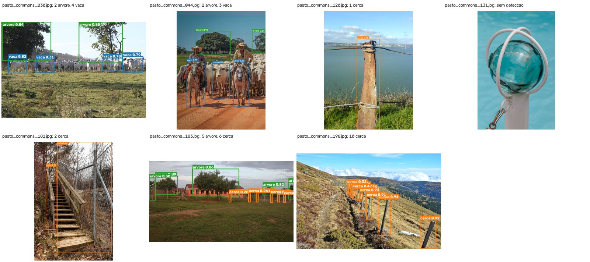

# FarmTech Solutions: visão computacional para um rover de pasto

**FIAP · Inteligência Artificial · Fase 6 (Redes Neurais e Visão Computacional)**
Autor: Jefferson Gonçalves Lemos (RM572399)

A FarmTech está prototipando um rover autônomo de inspeção de pasto. Neste repositório está o módulo
de visão que desenvolvi para esse rover: uma YOLO customizada que, a partir da câmera, responde onde
está o rebanho, se há risco biológico no caminho e por onde o rover pode andar. A solução completa
(dataset, treino, validação, teste, comparação com outras abordagens e conclusões) está documentada
passo a passo no notebook. Este README apenas apresenta o projeto e indica onde está cada parte.

| ID | Classe | Pergunta do rover | Observação |
|---:|---|---|---|
| 0 | `vaca` | Onde está o rebanho? | |
| 1 | `cobra` | Há risco biológico no caminho? | |
| 2 | `escorpiao` | Há risco biológico no caminho? | objeto pequeno, a classe mais difícil |
| 3 | `arvore` | Onde posso andar? | obstáculo |
| 4 | `cerca` | Onde posso andar? | a caixa é desenhada no **mourão**, não na cerca inteira |
| 5 | `caneca` | Nenhuma: não faz parte da cena do pasto | objeto da demonstração ao vivo com câmera no Ir Além |

A `caneca` não responde a uma pergunta do rover. Incluí essa classe porque a demonstração ao vivo do
Ir Além usa o celular como câmera Wi-Fi, e no ambiente de gravação não há vacas, cobras nem
escorpiões. Com a caneca, a detecção em tempo real pode ser mostrada com um objeto que está de fato
diante da câmera. Ela ocupa o último índice para que os rótulos já feitos das cinco classes do pasto
não precisem ser renumerados.

## Entregáveis

| Peça | Link |
|---|---|
| Notebook principal (Entregas 1 e 2) | [`JeffersonGoncalvesLemos_rm572399_pbl_fase6.ipynb`](JeffersonGoncalvesLemos_rm572399_pbl_fase6.ipynb) · [](https://colab.research.google.com/github/jeffersonGlemos/fiap-semestre1-fase6/blob/main/JeffersonGoncalvesLemos_rm572399_pbl_fase6.ipynb) |
| Notebook Ir Além | [`ir_alem/JeffersonGoncalvesLemos_rm572399_pbl_fase6_ir_alem.ipynb`](ir_alem/JeffersonGoncalvesLemos_rm572399_pbl_fase6_ir_alem.ipynb) |
| Vídeo: Entregas 1 e 2 (até 5 min) | <!-- TODO: link YouTube não listado --> _em breve_ |
| Vídeo: Ir Além (até 5 min) | <!-- TODO: link YouTube não listado --> _em breve_ |
| Vídeo: Por que Hailo (plus) | <!-- TODO: link YouTube não listado --> _em breve_ |

O notebook principal cobre:

- **Entrega 1:** YOLOv5 customizada, com duas simulações de quantidade de épocas bem diferentes
  (30 e 60) e análise de validação e teste por classe.
- **Entrega 2:** comparação com a YOLO padrão (pesos COCO) e com uma CNN treinada do zero, nos
  critérios de facilidade de uso, precisão, tempo de treino e tempo de inferência.



*Detecções do `best.pt` final numa imagem do conjunto de teste (gerada pelo notebook em `assets/`).*

No **Ir Além**, segui a opção 3.1 do enunciado: uma câmera transmite por Wi-Fi para um script Python
executado no VS Code, que reconhece os objetos com o modelo da Entrega 1. A câmera é um iPhone usado
pelo Safari, sem instalar nenhum app. O `camera_server.py`, rodando no Mac, serve a página `/celular`
por HTTPS com certificado autoassinado (o navegador só libera a câmera em contexto seguro), e o
celular abre essa página por um QR code exibido no terminal. A página envia os quadros em JPEG pelo
Wi-Fi ao Mac; o `cliente_vscode.py` roda o modelo oficial, o `best.pt` treinado no Colab com GPU L4,
e devolve as caixas ao celular em coordenadas normalizadas (0 a 1), que a página desenha sobre a
própria prévia da câmera. O enunciado fala em ler o `best.pt`. Na sessão registrada, usei o
`best.onnx` exportado desse mesmo `best.pt`, executado pelo ONNX Runtime com o provedor CoreML; o
cliente também carrega o `.pt` diretamente. Essa sessão (logs em `ir_alem/logs/`) registrou
15,0 FPS, latência fim a fim de 34,8 ms, RTT de rede de cerca de 4,3 ms e inferência de 7,0 ms, com
a caneca detectada em 212 dos 249 quadros.

Como plus, implementei a inferência embarcada num Raspberry Pi 5 com acelerador Hailo-8L: o backend
está em `ir_alem/backends/` e a conversão do modelo para `.hef` está documentada em `ir_alem/hailo/`.
Esse caminho não foi testado no hardware; a análise e as limitações estão no notebook do Ir Além.

## Estrutura do repositório

```
.
├── JeffersonGoncalvesLemos_rm572399_pbl_fase6.ipynb   notebook principal (Entregas 1 e 2)
├── README.md
├── assets/                    imagens de detecção do modelo final nas imagens de teste
├── rotulacao/                 dataset: download, rotulação automática, split e contagem
│   ├── pyproject.toml         ambiente uv (Python 3.12) dos scripts de rotulação
│   ├── uv.lock                versões exatas das dependências
│   ├── baixar_commons.py      fotos de pasto e de canecas do Wikimedia Commons + creditos.csv
│   ├── baixar_bancos.py       cobras e escorpiões do iNaturalist (licenças CC) + creditos.csv
│   ├── creditos.csv           autor, licença e links de cada imagem baixada
│   ├── coleta.py              captura com câmera própria (Pi ou webcam) para ampliar o lote A;
│   │                          não foi a origem do lote A atual
│   ├── autolabel.py           rotulação automática zero-shot com Grounding DINO
│   ├── labels.txt             as seis classes na ordem dos índices (labelmap do Roboflow)
│   ├── roboflow_sync.py       envio para a revisão no Roboflow Annotate e download da versão revisada
│   ├── roboflow.env.exemplo   modelo da configuração do Roboflow (chave, workspace e projeto)
│   ├── split.py               treino/val/teste por grupos de imagens, sem arquivo repetido entre conjuntos
│   ├── contagem.py            conferência do mínimo de 32/4/4 imagens por classe
│   ├── data.yaml              configuração do dataset para o YOLOv5 (caminho do Colab)
│   └── publicar_dataset.py    geração do zip público baixado pelo notebook
└── ir_alem/                   opção 3.1: câmera → Wi-Fi → VS Code, e o plus com Pi 5 + Hailo-8L
    ├── JeffersonGoncalvesLemos_rm572399_pbl_fase6_ir_alem.ipynb
    ├── camera_server.py       roda no PC ou no Pi: transmite as imagens da câmera (MJPEG); no modo
    │                          navegador, serve a página /celular; no plus, também faz a inferência
    ├── celular.html           página /celular: câmera do celular pelo navegador, envio dos quadros
    │                          e desenho das caixas devolvidas pelo PC
    ├── cliente_vscode.py      roda no PC: recebe as imagens, detecta, alerta e registra
    ├── exportar_modelo.py     best.pt → best_portavel.pt → best.onnx (e CoreML, opcional)
    ├── requirements-pc.txt    dependências do PC (cliente, servidor no modo navegador e exportação)
    ├── requirements-pi.txt    dependências do Raspberry Pi 5
    ├── modelos/
    │   └── best_portavel.pt   modelo oficial (o best.pt da Entrega 1, salvo de forma portável)
    ├── backends/              Hailo (.hef), ONNX e compat.py (carregamento portável do checkpoint)
    ├── esp32cam/              sketch do ESP32-CAM com as mesmas rotas HTTP
    ├── hailo/                 conversão documentada best.pt → ONNX → .hef (não testada no hardware)
    ├── logs/                  frames.csv e alertas.csv da sessão registrada com o celular
    └── figuras/               figura autoral da arquitetura
```

## Rotulação

```
autolabel.py → inspeção por amostragem → split.py → contagem.py
roboflow_sync.py → revisão no Roboflow Annotate   (imagens enviadas; revisão ainda não feita)
```

O enunciado sugere o Make Sense IA. Optei por outro fluxo porque, com seis classes e no mínimo 40
imagens por classe, desenhar todas as caixas do zero seria lento e tenderia a gerar caixas
inconsistentes entre sessões de trabalho. As caixas foram geradas automaticamente pelo Grounding
DINO, em modo zero-shot, com um prompt de texto por classe, limiar de confiança por classe, NMS por
classe e entre classes e descarte das caixas que cobrem a imagem inteira. Inspecionei o resultado
por amostragem, em mosaicos com as prévias de cada lote, e descartei à mão as imagens claramente
inadequadas (no lote de canecas, um balão em forma de caneca, canecas minúsculas e uma prateleira de
loja); imagens sem nenhuma caixa ficaram de fora. As caixas não foram revisadas uma a uma: as
imagens já estão no Roboflow (projeto `fase6`) e o `roboflow_sync.py` deixa pronto o fluxo de revisão
no Roboflow Annotate, mas essa revisão completa, prevista no fluxo, não foi feita nesta versão por
limitação de tempo. O efeito disso nas métricas está nas limitações do notebook. A exportação sai no
mesmo formato YOLO que o Make Sense geraria, então o restante do pipeline não muda.

O `split.py` separa treino, validação e teste por grupos de imagens: uma expressão regular aplicada
ao nome do arquivo (`--grupo`) define o grupo, e o grupo inteiro vai para o mesmo conjunto. Isso serve
para manter juntas as fotos em sequência capturadas pelo `coleta.py`, cujo nome traz data e hora. As
fotos atuais, do Wikimedia Commons e do iNaturalist, não têm data e hora no nome, então cada uma forma
um grupo próprio. O `contagem.py` confere o mínimo de 32/4/4 imagens por classe antes de qualquer
treino. O dataset final tem 376 imagens (336 de treino, 21 de validação e 19 de teste), todas as
seis classes acima desse mínimo e nenhum arquivo repetido entre conjuntos.
A discussão completa dessa etapa está no notebook.

## Como reproduzir

### Notebook principal

1. Abra o notebook principal no Colab pelo badge acima e ative uma GPU
   (*Ambiente de execução → Alterar o tipo de ambiente*), T4 ou superior; a execução registrada usou L4.
2. Execute todas as células. O dataset é baixado automaticamente de um link público, sem depender
   de acesso ao Drive do autor ([link público do dataset](https://drive.google.com/file/d/1CTyM69BKyGfSkuZKACGx7a7aXIpyRlEF/view)).
3. O Google Drive só é montado se `SALVAR_NO_DRIVE = True`, para guardar os resultados (`runs/` e
   pesos) entre sessões; nada mais no notebook depende dele.

### Dataset

O dataset pode ser refeito localmente com os scripts de `rotulacao/`. O `creditos.csv` versionado já
registra as 390 imagens baixadas, e os scripts de download pulam o que já está nele; por isso uma
reconstrução do zero grava os créditos num CSV novo (`--creditos`). Os bancos públicos mudam com o
tempo, então a lista exata das imagens usadas é a do `creditos.csv`, e os números das cinco canecas
descartadas na inspeção valem para aquele download.

```bash
cd rotulacao
uv sync
uv run baixar_commons.py brutas/pasto --quantidade 220 --creditos novo.csv
uv run baixar_commons.py brutas/caneca --classe caneca --quantidade 60 --sem-fundo-branco \
    --categorias "Coffee mugs" "Mugs with logos" "People with mugs" "Mugs with soup" "Mugs" \
    --excluir "museum|collection|\(AM " --creditos novo.csv
uv run baixar_bancos.py brutas/ --quantidade 55 --creditos novo.csv     # brutas/cobra e brutas/escorpiao

uv run autolabel.py brutas/pasto     saida_pasto/  --classes vaca,arvore,cerca
uv run autolabel.py brutas/cobra     saida/        --classes cobra
uv run autolabel.py brutas/escorpiao saida/        --classes escorpiao
uv run autolabel.py brutas/caneca    saida_caneca/ --classes caneca

# rotulado/: só as imagens com pelo menos uma caixa, sem as 5 canecas descartadas na inspeção
mkdir -p rotulado/images rotulado/labels
for txt in saida_pasto/labels/*.txt saida/labels/*.txt saida_caneca/labels/*.txt; do
  nome=$(basename "$txt" .txt)
  [ -s "$txt" ] || continue
  case "$nome" in caneca_commons_022|caneca_commons_025|caneca_commons_029|caneca_commons_034|caneca_commons_058) continue ;; esac
  cp "$txt" rotulado/labels/ && cp "${txt%/labels/*}/images/$nome.jpg" rotulado/images/
done

uv run split.py rotulado/ dataset/
uv run contagem.py dataset/
uv run publicar_dataset.py dataset/
```

Com o mesmo `rotulado/`, o `split.py` (semente 42) reproduz exatamente a divisão 336/21/19 do
dataset publicado. O envio ao Roboflow (`roboflow_sync.py`) exige copiar
`rotulacao/roboflow.env.exemplo` para `rotulacao/roboflow.env` e preencher a chave da API, já que
o `roboflow.env` fica fora do controle de versão.

### Ir Além

O modelo oficial está versionado em `ir_alem/modelos/best_portavel.pt` (YOLOv5s, 6 classes, 14 MB,
SHA-256 `3b3b2e2fef022928bd950d58d3cb806d1cfad9ffc203229f1d891663ae3617c5`). É o mesmo `best.pt` da
execução registrada no notebook, salvo de forma portável: o checkpoint original guarda objetos
`pathlib` do Python 3.13 em Linux, que não carregam no Python 3.12 nem no Windows. O `best.onnx` é
gerado a partir dele pelo `exportar_modelo.py`. Para repetir a sessão com o celular, no terminal do
VS Code e dentro de `ir_alem/`:

```bash
pip install -r requirements-pc.txt
python exportar_modelo.py --pesos modelos/best_portavel.pt           # gera modelos/best.onnx
python camera_server.py --fonte navegador                            # HTTPS na porta 8000 + QR code de /celular
python cliente_vscode.py --fonte https://<IP do Mac>:8000/stream --inseguro \
    --modelo modelos/best.onnx --provedor coreml                     # em outro terminal
```

Em Windows ou Linux, `--provedor auto` escolhe o provedor disponível, e `--modelo
modelos/best_portavel.pt` usa o PyTorch diretamente. As demais opções, inclusive o plus com Hailo,
estão no notebook do Ir Além.

## Créditos das imagens e licença

As fotos de pasto (`vaca`, `arvore`, `cerca`) formam o lote A do dataset e vêm do Wikimedia Commons,
das categorias *Cattle in Brazil*, *Pastures in Brazil*, *Wooden fences in Brazil*, *Fence posts* e
*Barbed wire fences* (com as subcategorias diretas). Aceitei apenas arquivos JPEG com licença CC0,
CC BY, CC BY-SA ou em domínio público e acima de uma resolução mínima, e dividi o total em cotas por
categoria para que o lote não ficasse composto só de fotos de gado. O download é feito por
`rotulacao/baixar_commons.py`.
As imagens de `cobra` e `escorpiao` vêm do iNaturalist: usei apenas observações *research grade*
cujas fotos têm licença CC0, CC BY ou CC BY-SA, baixadas por `rotulacao/baixar_bancos.py`.
As fotos de `caneca` formam o lote D e também vêm do Wikimedia Commons, baixadas pelo mesmo
`rotulacao/baixar_commons.py` e com os mesmos filtros de formato, licença (CC0, CC BY, CC BY-SA ou
domínio público) e resolução. Usei as categorias *Coffee mugs*, *Mugs with logos*, *People with
mugs*, *Mugs with soup* e *Mugs* (com as subcategorias diretas), com a mesma divisão em cotas.
Escolhi categorias de canecas em uso, com café, sopa ou na mão de alguém, porque na demonstração
ao vivo a caneca aparece sobre a mesa e não isolada como num catálogo; pelo mesmo motivo, o script
descarta peças de acervo de museu pelo título e fotos de produto pela borda quase toda branca.
Autor, licença e links de todas as imagens dos quatro lotes estão em
[`rotulacao/creditos.csv`](rotulacao/creditos.csv). O arquivo lista também 14 imagens baixadas que
não entraram no dataset: 9 em que o Grounding DINO não encontrou nenhuma caixa (4 de pasto e 5 de
canecas) e as 5 canecas descartadas na inspeção.
Dos bancos públicos baixei somente as imagens; todas as anotações foram geradas neste projeto.

Os rótulos (anotações) estão sob a licença **CC BY-SA 4.0**. Cada imagem mantém a licença original
indicada em `rotulacao/creditos.csv` (CC0, domínio público, CC BY ou CC BY-SA).
